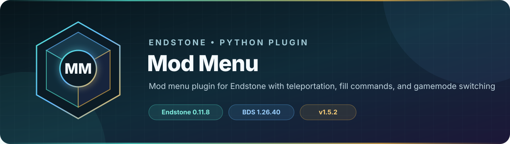

<!-- endstone-professional-header:start -->
<p align="center">
  
</p>

<p align="center">
  <a href="https://github.com/TheNINJALLO/endstone-mod-menu/actions/workflows/wheel-release.yml"></a>
  <a href="https://github.com/TheNINJALLO/endstone-mod-menu/releases/latest"></a>
</p>

<p align="center">
  
  
  
  =3.10" src="https://img.shields.io/badge/Python-%3E=3.10-3776AB?style=flat-square&amp;logo=python&amp;logoColor=white">
</p>

<p align="center">
  <strong>Mod menu plugin for Endstone with teleportation, fill commands, and gamemode switching.</strong>
</p>

<p align="center">
  <a href="#overview">Overview</a> &bull;
  <a href="#compatibility">Compatibility</a> &bull;
  <a href="#install">Install</a> &bull;
  <a href="https://github.com/TheNINJALLO/endstone-mod-menu/releases">Releases</a>
</p>

## Overview

Mod menu plugin for Endstone with teleportation, fill commands, and gamemode switching. This release is aligned with Endstone 0.11.8 and Minecraft Bedrock Dedicated Server 1.26.40, and is distributed as a Python wheel for direct installation in an Endstone server.

## Capabilities

-

## Compatibility

| Component | Supported version |
|---|---|
| Endstone | `0.11.8` |
| Endstone API | `0.11` |
| Bedrock Dedicated Server | `1.26.40` |
| Python | `>=3.10` |
| Plugin release | `v1.5.2` |

## Install

Download the wheel from the matching GitHub release:

```bash
gh release download v1.5.2 --repo TheNINJALLO/endstone-mod-menu --pattern "*.whl"
```

Copy the downloaded wheel into the server's `plugins/` directory, remove any older wheel for the same plugin, and restart Endstone.

> [!IMPORTANT]
> Use Endstone `0.11.8` with BDS `1.26.40`. Back up worlds and plugin data before upgrading a production server.

## Configuration and secrets

Runtime databases, logs, local `.env` files, server directories, and root `config.toml` files are excluded from source releases. When an example configuration is provided, copy it locally and keep live tokens, passwords, webhook URLs, and server identifiers out of Git.

## Release automation

Every `v*` tag runs [the wheel release workflow](.github/workflows/wheel-release.yml), builds the package in a clean GitHub runner, stores the wheel as a workflow artifact, and attaches it to the matching GitHub release.
<!-- endstone-professional-header:end -->

---

## Project guide

A comprehensive moderator menu plugin for Endstone (Minecraft Bedrock Dedicated Server) that provides essential moderation tools through an intuitive UI.

## Features

### Main Menu
- **Commands Submenu** - Access to advanced commands
- **Spectator Mode** - Quick switch to spectator with night vision
- **Survival Mode** - Return to survival and clear night vision

### Commands Menu
- **Teleport To** - Teleport to any online player
- **Teleport From** - Bring any player to your location
- **Fill Area** - Fill regions with deepslate blocks
- **Load Structure** - Load saved structures in front of you

### Special Features
- Automatic night vision when entering spectator mode
- Night vision cleared when returning to survival
- Volume limits on fill commands for safety (32,768 blocks)
- Support for relative coordinates (~, ~5, etc.)
- Permission-based access control

## Installation

1. Ensure you have Endstone 0.11.8+ installed
2. Clone or download this plugin
3. Install using pip:
   ```bash
   pip install .
   ```
4. Restart your Endstone server

## Usage

### Trigger the Menu
Simply type `/mod` command to open the mod menu (requires permission).

### Permissions
- Players with the `Mod` scoreboard tag can access the mod menu
- Players with the `Owner` scoreboard tag are protected from being teleported

Add tags using:
```
/tag <player> add Mod
/tag <player> add Owner
```

## Project Structure

```
endstone-mod-menu/
├── src/
│   └── endstone_mod_menu/
│       ├── __init__.py
│       └── mod_menu.py
├── pyproject.toml
└── README.md
```

## Configuration

Edit the constants in `mod_menu.py`:
- `FILL_VOLUME_LIMIT` - Maximum blocks for fill command (default: 32768)
- `NV_DURATION_TICKS` - Night vision duration in ticks (default: 999999)
- `NV_SHOW_PARTICLES` - Show particles for night vision effect (default: False)

## API Version
This plugin targets Endstone API version 0.10

## Commands

The plugin provides the `/mod` command to access the menu.

## Forms

The plugin uses Endstone's native form system:
- **ActionForm** - Main menu and commands menu
- **ModalForm** - Fill area and teleport player selection

## Events

Handles commands through the standard Endstone command system.

## Requirements

- Python 3.9+
- Endstone 0.11.8+
- Minecraft Bedrock Dedicated Server

## License

MIT License - See LICENSE file for details

## Support

For issues or questions, please open an issue on the project repository.

## Credits

Ported from Minecraft Bedrock Script API to Endstone by following the official Endstone documentation and API references.
